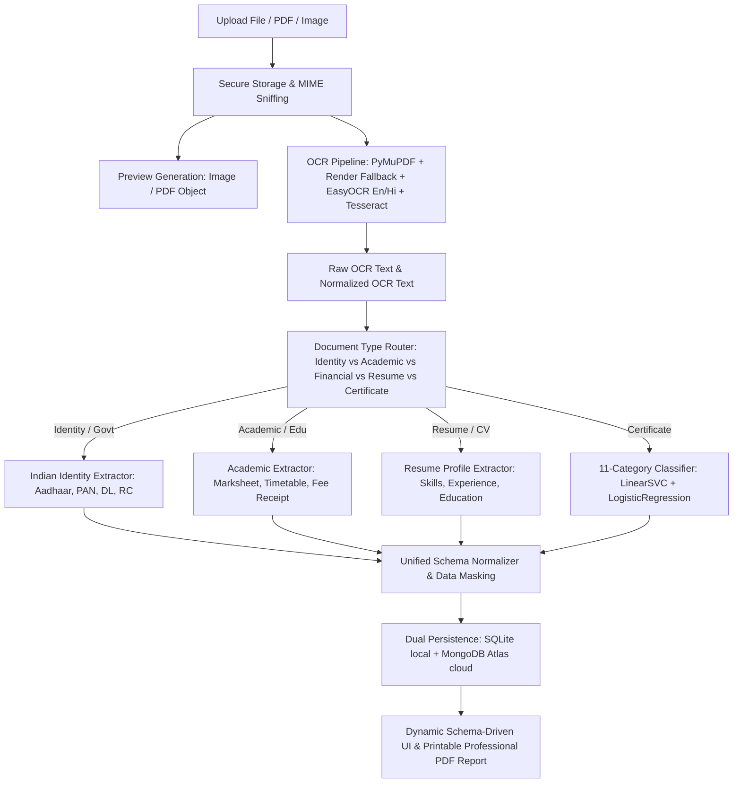

# CertiNexus AI — Unified Indian Document Intelligence & Dataset Streaming Implementation Plan

## Executive Summary
This document outlines the master implementation plan for **CertiNexus AI**, upgrading the platform to a unified Indian document intelligence and certificate intelligence platform. The upgrade integrates remote dataset streaming, multi-task ML pipelines, OCR repair for identity documents (Aadhaar, PAN, DL, RC), schema-driven extraction across educational and financial records, and end-to-end FastAPI/React integration while strictly adhering to a 10 GB data/cache budget.

---

## 1. Confirmed Root Causes

### 1.1 Aadhaar OCR Empty Text Bug (Image Visible but No Raw Text Available)
- **Root Cause A (Scanned / Image-Based PDFs)**: In `backend/app/api/certificates.py`, PDF documents were parsed exclusively with `fitz.open(file_path)` using `page.get_text()`. Scanned identity documents (e.g., e-Aadhaar scans, color photocopies) contain raster images without a vector text stream. `page.get_text()` returned an empty string (`""`), and the pipeline did not render PDF pages to pixmaps for OCR fallback.
- **Root Cause B (OCR Pipeline Exception Swallowing)**: In `ml/ocr/pipeline.py`, when EasyOCR failed to initialize or experienced a timeout on single-language (`["en"]`) processing, the fallback caught the exception and returned a placeholder string `"[Image certificate: ...]"` or `""`. The postprocessor then stripped it, leaving `raw_ocr_text = ""`.
- **Root Cause C (No Indic Language Support in OCR Pipeline)**: Aadhaar, PAN, and Indian state certificates contain bilingual text (English + Hindi, Tamil, Telugu, etc.). The OCR pipeline was hardcoded to English-only (`["en"]`), causing character recognition on Indic scripts to yield near-zero confidence or empty bounding boxes.

### 1.2 Over-Forced 11-Class Certificate Taxonomy
- **Root Cause**: All non-resume documents were fed directly into `CertificateClassifier.predict()`, forcing Aadhaar cards, PAN cards, marksheets, and fee receipts into certificate classes (e.g., "Certification", "Internship").
- **Resolution**: Implement a hierarchical Document Router separating Government/Identity, Academic Records, Financial Documents, Resumes, and 11-category Accredited Certificates.

### 1.3 Lack of Streaming Ingestion & Unbounded Data Footprints
- **Root Cause**: The repository had ad-hoc dataset references without a unified streaming loader or cache enforcement.
- **Resolution**: Build `backend/ml/data_sources/` with direct HuggingFace and WebDataset streaming, pinned revisions, bounded sampling, and a strict 10 GB cache budget manager.

---

## 2. Supported Indian Document Taxonomy

| Domain | Document Type | Key Target Extracted Fields | Masking / Privacy Rule |
| :--- | :--- | :--- | :--- |
| **Government / Identity** | **Aadhaar Card** | Full Name, DOB/Year, Gender, Address, Father/Husband Name, Masked Aadhaar # | Mask all but last 4 digits (`XXXX-XXXX-1234`) |
| **Government / Identity** | **PAN Card** | Name, Father's Name, DOB, Masked PAN Number | Mask digits (`ABCDE****F`) |
| **Government / Identity** | **Driving Licence (DL)** | Name, DL Number, Issue Date, Expiry Date, Vehicle Class, Issuing RTO | Mask middle digits |
| **Government / Identity** | **Vehicle Registration (RC)** | Reg Number, Owner Name, Vehicle Class, Maker/Model, Fuel Type, Reg Date | Plain Reg Number, Protect Chassis |
| **Government / Identity** | **Income / Residence / Domicile** | Applicant Name, Certificate No., Issuing Authority, State, Annual Income | Mask sensitive reference codes |
| **Government / Identity** | **Patta / Land Records** | Land Owner Name, Survey/Subdivision No., Village, Taluk, District, Area | Plain cadastral identifiers |
| **Academic & Educational** | **Semester Marksheet / Result** | Student Name, Roll/Reg No., Institution, Degree/Course, Semester, Subjects, Marks, Grades, SGPA/CGPA, Result Status | Protected Student ID |
| **Academic & Educational** | **Academic Timetable** | Institution, Department, Semester, Days, Time Slots, Subject Codes, Faculty | Open Schedule Data |
| **Academic & Educational** | **Fee Receipt** | Institution, Student Name, Receipt No., Payment Date, Amount, Payment Mode | Mask Bank/Transaction Hash |
| **Professional / Career** | **Resume / Curriculum Vitae** | Candidate Name, Email, Phone, Skills, Education, Experience, Projects | Mask Phone/Personal Address |
| **Accredited Credentials** | **11 Certificate Categories** | Recipient, Issuer, Event, Category, Issue Date, Credential ID, Skills | Preserved 11-class classification |

---

## 3. Architecture & Dependency Order

---

## 4. Dataset Catalog & Streaming Architecture

1. **Jwalit/kyc-document-extraction-vlm** (Hugging Face streaming):
   - Tasks: Indian KYC Document Extraction (Aadhaar, PAN, Passport).
   - Mode: Remote streaming with bounded iterator (no massive archive download).
2. **Faizaniqbal/BhartiOCR** (Hugging Face / WebDataset):
   - Tasks: Indic Script OCR (Devanagari, Tamil, etc.).
   - Mode: WebDataset shard streaming with bounded sample prefetching.
3. **Patram-Bench** (Layout & Indian Document Understanding):
   - Tasks: Layout analysis, table structure, document classification.
   - Mode: Programmatic streaming adapter.
4. **Mozhi Indic OCR**:
   - Tasks: Indic OCR evaluation and dictionary matching.
   - Mode: Bounded sample loader.
5. **CAPCC-v1** (Local Project Dataset):
   - Tasks: 11-category certificate classification.
   - Mode: Local dataset adapter with leak-free train/val/test splits.

---

## 5. Storage & 10 GB Budget Management

- Dedicated `StorageBudgetManager` tracking:
  - Downloaded shards and stream buffers.
  - Preprocessed image cache.
  - Model checkpoints and vectorizers.
- Enforces max cache limit of 10 GB with LRU eviction for temporary shards.
- Generates `DATA_STORAGE_REPORT.md`.

---

## 6. Implementation Checklist

- [ ] **Phase 1**: Audit repository, confirmed root causes, and write `IMPLEMENTATION_PLAN.md`.
- [ ] **Phase 2**: Implement `backend/ml/data_sources/` registry, base classes, streaming adapters, and `DATASET_CATALOG.md`.
- [ ] **Phase 3**: Enforce 10 GB budget with `StorageBudgetManager` and generate `DATA_STORAGE_REPORT.md`.
- [ ] **Phase 4**: Implement supported Indian document taxonomy in `ml/extraction/taxonomy.py`.
- [ ] **Phase 5**: Implement category-specific extraction schemas with PII masking in `ml/extraction/schemas.py`.
- [ ] **Phase 6**: Implement `IndianDocumentExtractor` for Aadhaar, PAN, DL, RC, Marksheets, Timetables, Fee Receipts.
- [ ] **Phase 7**: Implement `DocumentTypeRouter` with hierarchical routing.
- [ ] **Phase 8**: Repair OCR pipeline in `ml/ocr/` and `backend/app/api/certificates.py` with automatic PDF page rendering and Indic language support.
- [ ] **Phase 9**: Train and evaluate models reproducibly, producing `ML_EVALUATION_REPORT.md`.
- [ ] **Phase 10**: Integrate FastAPI endpoints and dual SQLite/MongoDB persistence.
- [ ] **Phase 11**: Update React UI (`CertificateDetails.jsx`) with dynamic schema-driven sections for all document types.
- [ ] **Phase 12**: Update report generation with print-friendly styling for all document types.
- [ ] **Phase 13**: Create comprehensive automated test suite and verify build.
